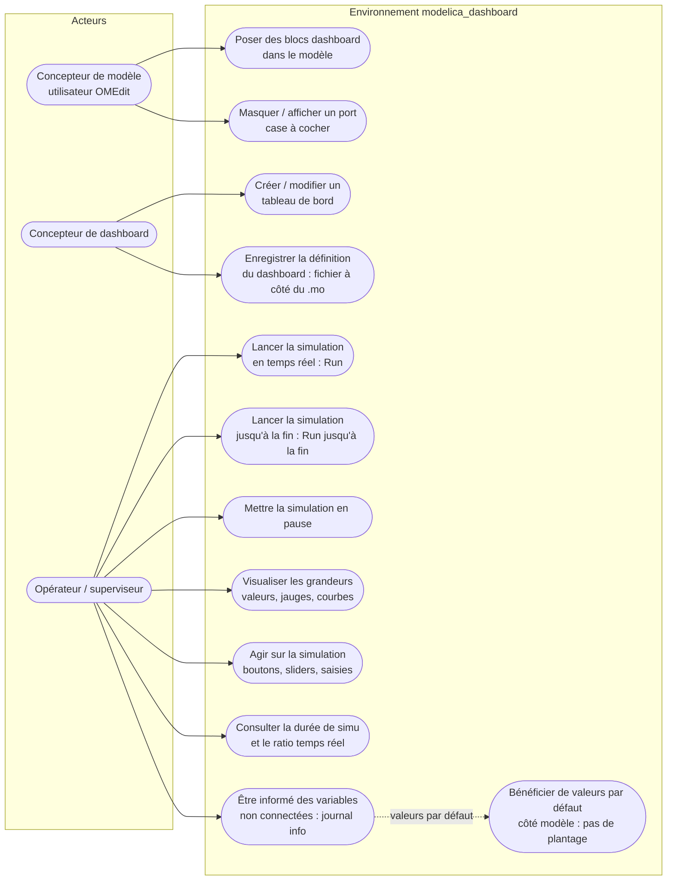

# Spécification de besoins — modelica_dashboard

**Projet** : environnement de tableaux de bord interactifs pour OpenModelica (exécution temps réel + supervision externe)
**Version** : 1.0
**Statut** : validée avec le demandeur

---

## 1. Contexte et objectifs

L'objectif est de constituer un **environnement complet** autour d'OpenModelica permettant :

1. d'exécuter un modèle Modelica en **mode temps réel** ;
2. de créer des **tableaux de bord** dans une application externe pour afficher des grandeurs et placer des **boutons / actionneurs** qui interagissent avec la simulation en cours.

L'environnement se compose de **trois éléments** :

| Élément | Rôle |
|---|---|
| **Bibliothèque OpenModelica** | Fournit les blocs d'interface (entrées/sorties) intégrables dans les modèles (types entier, booléen, flottant). |
| **Outil de création / modification de tableaux de bord** | Éditeur permettant de composer un dashboard (widgets, positions, connexions) de manière simple, sans installation. |
| **Outil d'affichage des tableaux de bord** | Viewer temps réel affichant grandeurs, courbes, jauges et commandes de pilotage de la simulation. |

---

## 2. Définitions

- **Bloc dashboard** : composant de la bibliothèque OpenModelica posé dans OMEdit. Une case à cocher dans ses paramètres permet de **masquer ou afficher son port**. Le port porte le **nom de la variable** du modèle à laquelle il est associé.
- **Widget** : élément visuel du tableau de bord (valeur, jauge, courbe, bouton, slider, texte, image, journal de messages, etc.).
- **Dashboard** : ensemble de widgets disposés sur une surface, défini dans un **fichier de définition** enregistré à côté du fichier `.mo` du modèle, sous un **nom libre choisi par l'utilisateur**.
- **Variable non connectée** : variable présente d'un seul côté (modèle ou dashboard).

---

## 3. Exigences fonctionnelles

### 3.1 Bibliothèque OpenModelica (EF-B)

- **EF-B1** — La bibliothèque fournit des blocs d'entrée et de sortie de types **entier, booléen et flottant**.
- **EF-B2** — Chaque bloc possède dans ses paramètres une **case à cocher** permettant de masquer ou d'afficher le port.
- **EF-B3** — Le port affiché porte le **nom de la variable du modèle** à laquelle le bloc est associé.
- **EF-B4** — Lorsqu'une variable existe côté Modelica mais **pas côté dashboard**, la simulation utilise une **valeur par défaut** et ne plante pas.

### 3.2 Outil de création / modification de dashboards (EF-E)

- **EF-E1** — L'outil propose une **palette complète de widgets** : jauges, courbes (historique), tableaux de valeurs, boutons, sliders, champs de saisie, textes, images, journal de messages, etc.
- **EF-E2** — L'outil doit être **simple à prendre en main** et ne nécessiter **aucune installation** (outil existant réutilisé si pertinent, ou application servie en local ouverte dans le navigateur).
- **EF-E3** — La définition du dashboard (liste des widgets, positions, connexions) est enregistrée dans un **fichier à côté du `.mo`**, sous un **nom libre choisi par l'utilisateur**.
- **EF-E4** — La modification du dashboard (ajout/suppression de widget) est possible **uniquement entre deux runs**, pas pendant la simulation.
- **EF-E5** — Un seul dashboard et un seul viewer sont actifs par modèle.

### 3.3 Outil d'affichage (viewer) (EF-V)

- **EF-V1** — Le viewer affiche la **durée de simulation** en cours.
- **EF-V2** — Le viewer propose un bouton **Run** (exécution en temps réel).
- **EF-V3** — Le viewer propose un bouton **Run jusqu'à la fin** : arrêt au **stopTime du modèle** ou à une **durée saisie par l'utilisateur**, en sortant du temps réel.
- **EF-V4** — Le viewer propose un bouton **Pause**.
- **EF-V5** — Si la simulation ne suit pas le temps réel (ratio 1:1), le **temps de simulation défile plus lentement** et une **jauge affiche le ratio** pour informer l'utilisateur du ralentissement.
- **EF-V6** — Lorsqu'une variable existe côté dashboard mais **pas côté Modelica**, le widget concerné affiche une **caractéristique visuelle de non-connexion**, et un message est versé dans la **sortie info / journal de messages** du dashboard. Ni la simulation ni le dashboard ne plantent.

### 3.4 Indépendance modèle / dashboard (EF-I)

- **EF-I1** — **Aucune recompilation** du modèle de co-simulation n'est nécessaire lorsqu'on ajoute ou supprime une entrée/sortie du dashboard : le modèle qui utilise le dashboard reste inchangé.

---

## 4. Exigences non fonctionnelles

- **ENF-1** — Forme des outils : **priorité à un plugin OMEdit** (onglet/fenêtre « Dashboard » dédiée et/ou vue intégrée au schéma du modèle). À défaut, application **web servie en local** ouverte dans le navigateur du poste, sans installation.
- **ENF-2** — Aucun composant de l'environnement ne doit être exposé publiquement (fonctionnement en local / loopback).
- **ENF-3** — La page de spécification est publiée dans le dépôt sous forme de **page web au format Zensical** (spécialité `besoin.md`).

---

## 5. Diagramme de cas des exigences

```mermaid
flowchart TB
    subgraph BIB["Bibliothèque OpenModelica"]
        direction TB
        EFB1["EF-B1<br/>Blocs entrée/sortie<br/>entier, booléen, flottant"]
        EFB2["EF-B2<br/>Case à cocher<br/>masquant/affichant le port"]
        EFB3["EF-B3<br/>Le port porte le nom<br/>de la variable du modèle"]
        EFB4["EF-B4<br/>Variable absente du dashboard<br/>= valeur par défaut côté Modelica,<br/>sans plantage"]
    end

    subgraph EDIT["Outil de création de dashboards"]
        direction TB
        EFE1["EF-E1<br/>Palette complète de widgets<br/>(jauges, courbes, tableaux,<br/>boutons, textes, journal...)"]
        EFE2["EF-E2<br/>Simple à prendre en main,<br/>aucune installation"]
        EFE3["EF-E3<br/>Définition du dashboard dans un<br/>fichier à côté du .mo, nom libre"]
        EFE4["EF-E4<br/>Modification du dashboard<br/>uniquement entre deux runs"]
        EFE5["EF-E5<br/>Un seul dashboard et un seul<br/>viewer par modèle"]
    end

    subgraph VIEW["Outil d'affichage (viewer)"]
        direction TB
        EFV1["EF-V1<br/>Affiche la durée de simulation"]
        EFV2["EF-V2<br/>Bouton Run (temps réel)"]
        EFV3["EF-V3<br/>Bouton Run jusqu'à la fin<br/>(stopTime ou durée saisie,<br/>hors temps réel)"]
        EFV4["EF-V4<br/>Bouton Pause"]
        EFV5["EF-V5<br/>Si la simu ralentit : le temps<br/>simulé défile plus lentement et<br/>une jauge affiche le ratio"]
        EFV6["EF-V6<br/>Variable absente côté modèle :<br/>widget marqué non connecté +<br/>message dans le journal info"]
    end

    subgraph ENV["Environnement"]
        direction TB
        EFI1["EF-I1<br/>Ajout/suppression d'E/S dashboard<br/>sans recompiler le modèle"]
        ENF1["ENF-1<br/>Plugin OMEdit prioritaire<br/>(fenêtre dédiée ou vue intégrée),<br/>sinon web servie en local"]
    end

    BIB ==> EFB1 & EFB2 & EFB3 & EFB4
    EDIT ==> EFE1 & EFE2 & EFE3 & EFE4 & EFE5
    VIEW ==> EFV1 & EFV2 & EFV3 & EFV4 & EFV5 & EFV6
    ENV ==> EFI1 & ENF1
```

---

## 6. Diagramme de cas d'utilisation

---

## 7. Hors périmètre / décisions actées

- **Hors périmètre** : modification du dashboard pendant un run (EF-E4 : entre deux runs uniquement).
- **Acté** : en cas de dépassement du temps réel, pas de rattrapage par à-coups — le temps simulé ralentit et la jauge de ratio informe l'utilisateur (EF-V5).
- **Acté** : un seul dashboard et un seul viewer par modèle (EF-E5).
- **Acté** : pas de recompilation du modèle lors des changements de dashboard (EF-I1).
