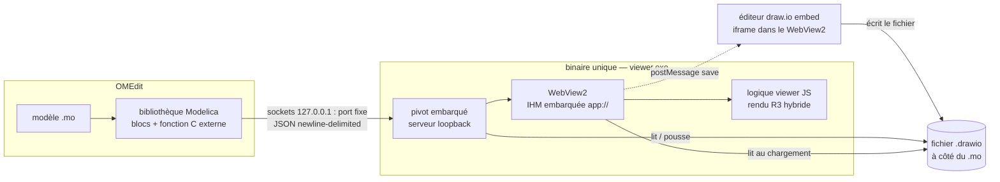

# Spécification technique — modelica_dashboard (architecture A4b)

**Projet** : environnement de tableaux de bord interactifs pour OpenModelica (exécution temps réel + supervision externe)
**Version** : 1.0
**Statut** : décisions tranchées avec le demandeur — document de référence pour l'implémentation
**Références** : [Spécification de besoins](besoin.md) (EF/ENF), [Options techniques](option_technique.md), [Options d'architecture](options_archtecture.md) (A4b retenue), [ADR](adr/) (décisions actées)

---

## 0. Principe de ce document

Ce document spécifie l'**architecture A4b** retenue : un **binaire unique** (viewer + pivot embarqué) avec WebView2 pour le viewer temps réel, et un **éditeur externe** (draw.io self-hosté en mode embed). Les quatre blocs — bibliothèque Modelica, pivot, viewer, éditeur — sont présentés à l'utilisateur de façon monolithique, mais **cloisonnés en modules** pour la maintenabilité et la testabilité. Toutes les interfaces entre composants sont décrites de façon exhaustive.

Les décisions structurantes sont consignées sous forme d'[ADR](adr/) ; le tableau ci-dessous en est le résumé.

| # | Sujet | Décision retenue | ADR |
|---|---|---|---|
| D1 | Plateformes V1 | Windows uniquement | [0001](adr/0001-architecture-a4b.md) |
| D2 | Granularité / placement du pivot | P3 — pivot embarqué dans le binaire viewer, un seul livrable | [0001](adr/0001-architecture-a4b.md) |
| D3 | Canal modèle ↔ pivot | Sockets TCP sur 127.0.0.1, 100–1000 variables à 10–100 Hz | [0003](adr/0003-canal-sockets-loopback.md) |
| D4 | Framing du protocole | JSON texte (newline-delimited) si perfs validées, repli binaire length-prefixed | [0003](adr/0003-canal-sockets-loopback.md) |
| D5 | Adressage sim → viewer | Port fixe par défaut sur 127.0.0.1 | [0002](adr/0002-pivot-embarque-port-fixe.md) |
| D6 | Éditeur | draw.io self-hosté, mode embed (`?embed=1&proto=json`) | [0004](adr/0004-editeur-drawio.md) |
| D7 | Format du fichier dashboard | `.drawio` natif (XML mxGraphModel) | [0004](adr/0004-editeur-drawio.md) |
| D8 | Rendu du viewer | R3 hybride : moteur draw.io pour la structure, canvas superposé pour courbes/jauges | [0004](adr/0004-editeur-drawio.md) |
| D9 | Chargement de l'IHM | Ressources embarquées + protocole custom `app://`, pont natif `PostWebMessage` | [0005](adr/0005-webview2-app-embarque.md) |
| D10 | Lancement / pilotage | L'utilisateur lance le viewer ; la sim est lancée depuis OMEdit ; boutons Run/Pause/Stop côté viewer | [0002](adr/0002-pivot-embarque-port-fixe.md) |
| D11 | Chargement du dashboard | Deux modes : auto (le modèle pousse le chemin du fichier en début de sim) ou manuel (chargé par l'utilisateur) | [0002](adr/0002-pivot-embarque-port-fixe.md) |
| D12 | Fichier dashboard — qui écrit/lit | C2 — éditeur écrit, viewer lit (à réévaluer) | [0004](adr/0004-editeur-drawio.md) |
| D13 | Rechargement entre deux runs (EF-E4) | Bouton **Recharger** manuel | [0002](adr/0002-pivot-embarque-port-fixe.md) |
| D14 | Binding par nom (EF-I1) | API runtime du moteur de simulation, résolution à l'exécution | [0006](adr/0006-binding-runtime.md) |
| D15 | Valeur par défaut (EF-B4) | `defaultValue` du bloc si jamais de valeur reçue, sinon dernière valeur reçue conservée | [0006](adr/0006-binding-runtime.md) |
| D16 | Livrable viewer+pivot | Exe autonome unique, C++/Win32 + WebView2 (L2) | [0007](adr/0007-livraison.md) |
| D17 | Distribution bibliothèque | Package Modelica standard dans les libraries OMEdit + DLL C externe | [0007](adr/0007-livraison.md) |
| D18 | CI | GitHub Actions, job Windows simple ; build + tests rejouables en local par le même script | [0008](adr/0008-ci-tests.md) |
| D19 | Tests | Unitaires + intégration + contrat (golden-file) ; logique JS en Node ; pas d'E2E WebView en V1 | [0008](adr/0008-ci-tests.md) |
| D20 | Versioning | SemVer produit + champ `version` dans le fichier et le protocole ; lecture de la version N-1 garantie | [0009](adr/0009-versioning.md) |
| D21 | Langues UI | Français + anglais dès la V1, chaînes externalisées | [0010](adr/0010-i18n-logs.md) |
| D22 | Logs | Fichier log par composant + journal dans l'UI (EF-V6) | [0010](adr/0010-i18n-logs.md) |
| D23 | Sécurité | Loopback + validation de taille max uniquement — **risque accepté, documenté, à réévaluer** (voir §10) | [0011](adr/0011-securite.md) |
| D24 | Backpressure | Le pivot pousse, le viewer écrase (seule la valeur la plus récente compte) | [0012](adr/0012-perf.md) |
| D25 | Multi-instances | Un viewer = une simulation (EF-E5 strict) ; une 2ᵉ sim sur le port fixe est refusée | [0002](adr/0002-pivot-embarque-port-fixe.md) |
| D26 | Port fixe du canal | `127.0.0.1:51234` | [0013](adr/0013-decisions-mise-en-oeuvre.md) |
| D27 | OpenModelica cible | v1.27.1 (dernière release stable) épinglée pour biblio, DLL et CI | [0013](adr/0013-decisions-mise-en-oeuvre.md) |
| D28 | Cœur risqué | POC/spike en parallèle du socle (binding par nom, commandes, temps réel) | [0013](adr/0013-decisions-mise-en-oeuvre.md) |
| D29 | Contrat du canal | `docs/protocole.md` rédigé avant le code ; code et golden files s'y conforment | [0013](adr/0013-decisions-mise-en-oeuvre.md) |
| D30 | Mécanisme de l'éditeur | draw.io en **iframe dans le WebView2**, servi via `app://`, piloté par `postMessage` (corrige §5/§8.6 : plus de navigateur externe ni de mini-serveur HTTP) | [0013](adr/0013-decisions-mise-en-oeuvre.md) |
| D31 | Versions de départ | Produit v0.1.0, protocole `version: 0`, `dashboardVersion="0"` | [0013](adr/0013-decisions-mise-en-oeuvre.md) |
| D32 | Widgets V1 | `value`, `gauge`, `curve`, `button`, `slider`, `log` (text/image/table en V2) | [0013](adr/0013-decisions-mise-en-oeuvre.md) |
| D33 | Stack C++ | C++20 + CMake, nlohmann/json, Catch2 v3 (CTest), logique JS testée en Node LTS | [0013](adr/0013-decisions-mise-en-oeuvre.md) |
| D34 | draw.io embarqué | v32.3.0, build statique webapp dans `viewer/third_party/` | [0013](adr/0013-decisions-mise-en-oeuvre.md) |
| D35 | Taille max de trame | 1 MiB par ligne NDJSON | [0013](adr/0013-decisions-mise-en-oeuvre.md) |
| D36 | Langue UI par défaut | Français (sélecteur FR/EN conservé) | [0013](adr/0013-decisions-mise-en-oeuvre.md) |
| D37 | Logs | `%LOCALAPPDATA%\modelica_dashboard\logs\{viewer,pivot,sim}.log` | [0013](adr/0013-decisions-mise-en-oeuvre.md) |
| D38 | DLL C externe | `DashboardExternal.dll`, exports préfixés `dashboard_` (contrat finalisé au POC) | [0013](adr/0013-decisions-mise-en-oeuvre.md) |
| D39 | `showPort` (EF-B2) | Visé : `Placement(visible=showPort)` ; à valider au POC, repli documenté | [0013](adr/0013-decisions-mise-en-oeuvre.md) |
| D40 | État sim→pivot | Message `state` sim→pivot ajouté au protocole (alimente `simState`) | [0013](adr/0013-decisions-mise-en-oeuvre.md) / [protocole.md](protocole.md) |
| D41 | Ordre de dev | protocole.md → socle shared/ + contrat + CI → POC parallèle → pivot → biblio+DLL → viewer → éditeur iframe | [0013](adr/0013-decisions-mise-en-oeuvre.md) |

---

## 1. Architecture globale



Flux de données :

1. L'utilisateur lance `viewer.exe` (éventuellement avec le chemin du dashboard en argument).
2. Le pivot écoute sur **127.0.0.1:51234** (D26 ; contrat détaillé dans [protocole.md](protocole.md)).
3. L'utilisateur lance la simulation depuis OMEdit ; la fonction C externe de la bibliothèque se connecte au port fixe et s'identifie (handshake, §8.2).
4. En mode **auto**, la sim pousse le chemin du fichier dashboard ; en mode **manuel**, l'utilisateur charge le dashboard dans le viewer.
5. Pendant le run : la sim pousse les valeurs à chaque pas de solveur (sim → pivot → WebView) ; les actionneurs et commandes (Run/Pause/Stop) font le chemin inverse (WebView → pivot → sim).
6. Entre deux runs, l'utilisateur édite le dashboard dans draw.io (éditeur externe) puis clique sur **Recharger** dans le viewer (EF-E4).

---

## 2. Bloc 1 — Bibliothèque Modelica

### 2.1 Contenu

- Package Modelica `Dashboard` (dossier standard, installé dans les libraries OMEdit — D17) contenant :
  - blocs `Dashboard.Input` et `Dashboard.Output` pour **Real, Integer, Boolean** (EF-B1) ;
  - paramètre booléen `showPort` (case à cocher, masquer/afficher le port — EF-B2) ;
  - paramètre `variableName` : nom de la variable du modèle à laquelle le bloc est associé (EF-B3, conséquence de l'exclusion du plugin OMEdit) ;
  - paramètre `defaultValue` (typé selon le bloc) utilisé si la variable n'a jamais reçu de valeur du dashboard (EF-B4, D15) ;
  - paramètre `dashboardFile` (chemin du fichier `.drawio`) utilisé en mode **auto** pour pousser le dashboard au pivot en début de simulation (D11).
- Fonction C externe (DLL distribuée avec le package) appelée par les blocs, résolvant les variables **par nom à l'exécution** via l'API runtime du moteur de simulation (D14, EF-I1).

### 2.2 Comportement de la fonction C externe

- **Au démarrage de la simulation** : connexion TCP à `127.0.0.1:51234` (D26) ; handshake (§8.2) incluant la liste des noms de variables du modèle (`variableName` des blocs visibles) et, en mode auto, le `dashboardFile`.
- **Résolution par nom (EF-I1)** : à chaque appel, la fonction C interroge la table des variables du runtime compilé (nom → adresse/valeur). Aucune recompilation n'est nécessaire quand le dashboard change.
- **Valeur par défaut (EF-B4, D15)** : si le nom n'a jamais été résolu côté dashboard → `defaultValue` du bloc ; si une valeur a déjà été reçue → dernière valeur reçue conservée.
- **Pendant le run** : à chaque pas de solveur, envoi des sorties des blocs vers le pivot (données, §8.3) ; réception et application des actionneurs reçus du pivot.
- **Non-connexion** : si un nom du dashboard n'existe pas dans le modèle, la sim ne plante pas ; le pivot marque la variable non connectée et la signale au viewer (EF-V6, §8.4).

### 2.3 Distribution

Dossier `Dashboard/` (fichiers `.mo` + `package.mo` + `Resources/` contenant la DLL C) à copier dans les Modelica libraries d'OMEdit ; le chemin de la DLL déclaré dans la configuration OMEdit (annotation `__OpenModelica_commandLineOptions` ou `OMC_LIB`). Aucun installeur (D17).

---

## 3. Bloc 2 — Pivot (embarqué dans le binaire viewer)

### 3.1 Rôle

Serveur loopback embarqué dans `viewer.exe` (D2) : accepte **une seule** connexion de simulation (D25), reçoit les sorties du modèle, les distribue au viewer, reçoit les actionneurs/commandes du viewer et les retransmet à la sim, lit/pousse le fichier dashboard.

### 3.2 Cycle de vie

1. Démarrage du viewer → le pivot ouvre `127.0.0.1:51234` (D26) en écoute.
2. Connexion d'une sim → handshake validé → état `CONNECTED`. Toute connexion supplémentaire est **refusée** (log + message d'erreur), conformément à EF-E5/D25.
3. Réception du dashboard (mode auto poussé par la sim, ou mode manuel demandé par l'utilisateur) → lecture du fichier `.drawio` → envoi au viewer + résolution des noms (intersection noms modèle ∩ noms dashboard) :
   - nom présent des deux côtés → flux actif ;
   - nom côté modèle seul → valeur par défaut appliquée (EF-B4) ;
   - nom côté dashboard seul → widget marqué **non connecté** + message dans le journal (EF-V6).
4. Run : relais des données sim → viewer à chaque pas ; relais des commandes viewer → sim.
5. Déconnexion de la sim → retour à l'état d'écoute (nouvelle sim possible).

### 3.3 Backpressure (D24)

Le pivot pousse toutes les valeurs à chaque pas sans jamais bloquer la simulation ; si le viewer est lent, seules les valeurs les plus récentes sont affichées (les intermédiaires sont écrasés côté WebView).

---

## 4. Bloc 3 — Viewer (WebView2 embarqué)

### 4.1 Conteneur

- Binaire C++/Win32 unique (D16), WebView2 (runtime Edge/Chromium déjà présent sur Windows 10/11 — D1, zéro installation supplémentaire).
- IHM (HTML/JS/CSS) **embarquée dans l'exe**, servie via un protocole custom `app://` enregistré dans WebView2 (D9). Aucun port HTTP ouvert pour l'UI ; le seul port ouvert est celui du canal modèle ↔ pivot (ENF-2).
- Échanges C++ ↔ JS via le pont natif (`CoreWebView2::PostWebMessageAsString` / `WebMessageReceived`), messages JSON structurés.
- Flag `--dev` au lancement : ouvre le `remote-debugging-port` pour le débogage devtools.

### 4.2 Fonctions (EF-V)

- Affichage de la **durée de simulation** en cours (EF-V1).
- Boutons **Run** (temps réel, EF-V2), **Run jusqu'à la fin** (stopTime du modèle ou durée saisie, sortie du temps réel, EF-V3), **Pause** (EF-V4) — envoyés au pivot comme commandes (§8.5).
- **Jauge de ratio** temps réel/simulé (EF-V5) : si la sim ne suit pas le temps réel, le temps simulé défile plus lentement (pas de rattrapage par à-coups) et la jauge affiche le ratio.
- Widgets du dashboard rendus selon R3 (D8) : structure/layout par le moteur draw.io (`viewer-static.min.js` en lecture seule, cellules mises à jour via l'API mxGraph), courbes d'historique et jauge de ratio en **canvas HTML superposé** positionné sur les cellules concernées.
- **Journal de messages** (EF-V6) : variables non connectées, erreurs de protocole, événements de cycle de vie.
- Bouton **Recharger** (D13) : relit le fichier `.drawio` entre deux runs (EF-E4).
- Bouton **Éditer** : ouvre l'éditeur (draw.io en iframe dans le WebView2, D30) sur le dashboard courant.
- I18n FR/EN (D21) : chaînes externalisées, sélecteur de langue.

### 4.3 Cloisonnement

La logique du viewer (rendu R3, gestion des widgets, traitement des messages du pivot, i18n) est isolée dans une **bibliothèque JS testable en Node** ; le WebView2 n'est qu'une coquille d'affichage qui charge cette bibliothèque via `app://` et branche le pont natif (D19). Cela rend la logique testable sans WebView.

---

## 5. Bloc 4 — Éditeur (iframe draw.io dans le WebView2)

- **draw.io self-hosté en mode embed** (`?embed=1&proto=json&configure=1`), build statique (**v32.3.0**, D34) embarqué dans `viewer.exe` et servi via le protocole custom `app://` (D9/D30) dans une **iframe du WebView2** — aucun mini-serveur HTTP, aucun navigateur externe, aucun port supplémentaire (ENF-2 renforcé).
- L'iframe est pilotée par `postMessage` : l'hôte envoie `load` (XML du dashboard courant), reçoit `save`/`autosave` (XML).
- **Écriture du fichier (C2, D12)** : à chaque `save`, notre application écrit le XML **à côté du `.mo`**, sous le nom choisi par l'utilisateur (EF-E3). Aucun stockage propre côté draw.io.
- **Palette de widgets (EF-E1, D32)** : bibliothèques de formes custom au format `<mxlibrary>` servies via `app://`, une forme par type de widget V1 (`value`, `gauge`, `curve`, `button`, `slider`, `log`).
- **Sécurité** : le XML reçu n'est **jamais injecté via `innerHTML`** ; il est écrit tel quel sur disque et rendu côté viewer uniquement via le moteur draw.io ou un parser XML propre.
- L'édition n'est possible qu'entre deux runs (EF-E4) : le bouton Éditer est désactivé pendant un run.

---

## 6. Format du fichier dashboard (`.drawio`)

- Format natif draw.io : `<mxfile><diagram><mxGraphModel><root><mxCell …/></root></mxGraphModel></diagram></mxfile>` (D7).
- Chaque widget = une cellule `UserObject` avec attributs personnalisés :
  - `dashboardVersion` (entier, champ de version du format — D20/D31, **0 en V1**) sur l'élément racine `mxfile` ;
  - `type` : type de widget V1 (`value`, `gauge`, `curve`, `button`, `slider`, `log` — D32 ; `text`, `image`, `table` en V2) ;
  - `variable` : nom de la variable Modelica associée (résolution par nom, EF-I1) ;
  - attributs de style/position natifs mxGraph (`style`, `geometry`, `vertex="1"`…).
- Le fichier est enregistré **à côté du `.mo`**, sous un **nom libre choisi par l'utilisateur** (EF-E3).
- **Versioning (D20)** : un lecteur de version N sait lire les fichiers de version N-1 (champs inconnus ignorés) ; un fichier de version supérieure ou trop ancienne produit un message d'erreur explicite dans le journal. Le même champ `version` figure dans chaque message du protocole (§8).
- **Un seul dashboard actif par modèle** (EF-E5) : le viewer ne charge qu'un fichier à la fois.

---

## 7. Architecture du code (arborescence du dépôt)

Monorepo, sous-dossiers par composant, **chacun avec son propre build** (décision finale) ; `docs/` (Zensical) inchangé à la racine.

```
modelica_dashboard/
├── docs/                  # Zensical : besoin, options, spec_technique, contributeur, protocole, utilisateur, adr/
├── viewer/                # binaire C++/Win32 : pivot embarqué + WebView2 + IHM embarquée (app://) + draw.io self-hosté
│   ├── CMakeLists.txt     # build propre du composant
│   ├── src/cpp/           # pivot (serveur loopback), hôte WebView2, pont natif, iframe éditeur
│   ├── src/web/           # bibliothèque JS du viewer (testable en Node) + assets IHM embarqués
│   └── third_party/       # draw.io build statique embarqué
├── modelica/              # package Modelica Dashboard + fonction C externe (DLL)
│   ├── Dashboard/         # .mo (blocs, paramètres)
│   └── csrc/              # fonction C externe, build propre (DLL)
├── shared/                # contrat commun aux composants : schéma du protocole, parsing/validation du .drawio, version
│   └── CMakeLists.txt     # bibliothèque statique partagée viewer ↔ tests
├── tests/                 # unitaires + intégration + contrat (golden-file)
└── scripts/               # build.ps1 / build.sh : rejoue la séquence exacte de la CI en local
```

Règles de cloisonnement :

- `viewer/`, `modelica/`, `shared/` ne se référencent que via `shared/` (contrat) — pas d'include croisé.
- La logique JS du viewer (`viewer/src/web/`) ne dépend d'aucune API WebView2 : le pont natif est injecté, ce qui permet de la tester en Node (D19).
- Chaque composant buildable seul (`cmake --build` dans son dossier) ; `scripts/build.ps1` orchestre le build complet + tests + packaging.

---

## 8. Interfaces entre composants (exhaustives)

### 8.1 Canal modèle ↔ pivot — transport

- **Transport** : TCP sur `127.0.0.1:51234` (port fixe, D5/D26 ; contrat complet dans [protocole.md](protocole.md)). Une seule connexion acceptée (D25).
- **Framing** : JSON texte **newline-delimited** (un objet JSON par ligne) si les benchmarks à 1000 variables × 100 Hz le permettent (D4) ; repli : trames binaires length-prefixed `[uint32 longueur][uint8 type][payload]`.
- **Validation** : taille maximale par trame **1 MiB** (D35, D23) ; à réévaluer (voir §10).

### 8.2 Handshake (sim → pivot, à la connexion)

```json
{"type": "hello", "version": 0, "role": "simulation",
 "variables": ["a.b", "c.d"],
 "dashboardFile": "C:\\models\\Modele.dashboard.drawio"}
```

- `version` : version du protocole (D20/D31, **0 en V1**).
- `variables` : noms (`variableName`) des blocs visibles du modèle.
- `dashboardFile` : présent uniquement en mode **auto** (D11) ; absent en mode manuel.
- Réponse du pivot : `{"type": "helloAck", "version": 0, "status": "ok"}` ou `{"type": "error", "code": "…", "message": "…"}` (ex. version non supportée, connexion refusée car sim déjà active).

### 8.3 Données (sim → pivot → viewer)

Un message par pas de solveur, batchant toutes les variables mises à jour :

```json
{"type": "data", "version": 0, "seq": 1234, "time": 12.34,
 "values": {"a.b": 1.5, "c.d": true}}
```

Le pivot ajoute le ratio temps réel/simulé (EF-V5) avant retransmission au viewer : `{"type": "tick", "version": 0, "seq": 1234, "simTime": 12.34, "ratio": 0.98, "values": {…}}`.

Un message d'état sim→pivot complète le flux (D40) : `{"type": "state", "version": 0, "state": "running|paused|stopped|finished"}`.

### 8.4 Signaux d'état (pivot → viewer)

- `{"type": "unconnected", "version": 0, "variables": ["x.y"]}` — variables du dashboard absentes du modèle (EF-V6) : widget en état visuel de non-connexion + message dans le journal.
- `{"type": "dashboard", "version": 0, "source": "auto|manual", "file": "…", "xml": "<mxfile>…"}` — push du dashboard (mode auto) ou confirmation de chargement (mode manuel).
- `{"type": "simState", "version": 0, "state": "running|paused|stopped|finished"}`.

### 8.5 Commandes (viewer → pivot → sim)

```json
{"type": "cmd", "version": 0, "cmd": "run"}
{"type": "cmd", "version": 0, "cmd": "pause"}
{"type": "cmd", "version": 0, "cmd": "runToEnd", "duration": 10.0}
{"type": "cmd", "version": 0, "cmd": "stop"}
{"type": "cmd", "version": 0, "cmd": "set", "variable": "a.b", "value": 2.0}
```

`runToEnd` sans `duration` s'arrête au `stopTime` du modèle (EF-V3). Les `set` sont les actionneurs (boutons, sliders) appliqués à la sim.

### 8.6 Interface viewer ↔ éditeur (draw.io embed, iframe dans le WebView2 — D30)

- L'éditeur draw.io (build statique embarqué, D34) est servi via `app://` et chargé dans une **iframe du WebView2** — pas de navigateur externe, pas de mini-serveur HTTP.
- `postMessage` : hôte → iframe `{"action": "load", "xml": "…"}` ; iframe → hôte `{"event": "save", "xml": "…"}` / `{"event": "autosave", "xml": "…"}`.
- À chaque `save`, l'hôte écrit le XML dans le fichier dashboard (C2, D12). L'édition est bloquée pendant un run (EF-E4).

### 8.7 Interface composants ↔ fichier dashboard

- **Éditeur** : écrit le XML (via l'hôte, §8.6).
- **Viewer** : lit le fichier au chargement et au clic sur **Recharger** (D13).
- **Modèle (fonction C)** : en mode auto, pousse seulement le **chemin** du fichier au pivot (M1/M2 lecture seule côté modèle) ; ne parse jamais le XML.

### 8.8 Pont natif WebView2 (C++ ↔ JS du viewer)

- C++ → JS : `PostWebMessageAsString` avec les messages `tick`, `simState`, `unconnected`, `dashboard` (§8.3–8.4) encapsulés.
- JS → C++ : `window.chrome.webview.postMessage` avec les commandes `cmd` (§8.5), `loadDashboard(path)`, `reload()`, `openEditor()`.
- La bibliothèque JS du viewer reçoit ces messages via une interface de pont injectée (testable en Node avec un pont simulé — D19).

---

## 9. Architecture des tests

Pyramide retenue (D19) : **unitaires + intégration + contrat**, pas d'E2E WebView en V1.

| Niveau | Cible | Outil / lieu |
|---|---|---|
| **Unitaires** | Parsing/validation du `.drawio`, protocole (sérialisation, validation de trames), pivot C++ avec sockets mockés, logique JS du viewer en Node (pont simulé) | C++ : framework de test unitaire (ex. Catch2) via CTest ; JS : runner Node (`node --test`) |
| **Intégration** | Modèle de démo compilé par `omc`, lancé en script ; flux réel sur le port fixe : handshake, data, commandes, mode auto/manuel, EF-B4/EF-V6 | `tests/integration/`, script Python ou PowerShell, exécuté en local et en CI |
| **Contrat (golden-file)** | Fichier `.drawio` de référence + vecteurs de messages JSON du protocole, regénérés et comparés à chaque build | `tests/contract/` ; toute évolution du format/protocole fait échouer le test volontairement → versionnage explicite (D20) |

- **CI** (D18) : workflow GitHub Actions `build.yml` sur `windows-latest` : build de chaque composant, tests unitaires (CTest), tests d'intégration, tests de contrat, packaging de l'exe, publication en artifact ; release GitHub sur tag `v*.*.*`.
- **Rejouable en local** : `scripts/build.ps1` exécute exactement la même séquence que la CI (build → ctest → intégration → contrat → package).
- **Non couvert en V1** : E2E sur le WebView2 réel (le viewer est testé via sa logique JS isolée, §4.3). À ajouter en V2 si besoin.

---

## 10. Sécurité (ENF-2)

- **Loopback strict** : le seul port TCP ouvert est `127.0.0.1:51234` (canal, D26) ; l'IHM du viewer et l'éditeur draw.io sont servis via `app://` (ressources embarquées, iframe dans le WebView2 — D30), sans aucun port HTTP. Aucun composant n'est exposé publiquement (ENF-2).
- **WebView** : IHM servie uniquement via `app://` (ressources embarquées) — pas de navigation externe possible, pas de `file://`.
- **Validation des entrées** : taille maximale par trame sur le canal : **1 MiB** (D23/D35).
- **XML** : jamais d'injection via `innerHTML` (§5).
- ⚠️ **Risque accepté, à réévaluer (D23)** : au-delà de la taille max, aucune validation sémantique des trames (pas de vérification d'enum de type, de jeu de caractères des noms, ni d'authentification de la connexion). Tout processus local peut envoyer des données forgées sur le port fixe. Ce risque est accepté en V1 (menace limitée aux processus de confiance sur le poste) et **doit être réévalué** si le périmètre change (multi-utilisateur, port configurable, exposition réseau). Voir [ADR-0011](adr/0011-securite.md).

---

## 11. Système de livraison

- **Viewer + pivot** : un seul exe autonome `viewer.exe` (C++/Win32 + WebView2, IHM et draw.io embarqués — D16, L2). Zéro installation (EF-E2). Distribué en **release GitHub** (artifact du job CI sur tag `v*.*.*`).
- **Bibliothèque Modelica** : package `Dashboard/` + DLL C externe, distribué en zip à copier dans les libraries OMEdit (D17) ; procédure documentée dans la doc utilisateur.
- **Éditeur** : embarqué dans l'exe (build statique draw.io servi en local) — rien à installer séparément (EF-E2).
- **Documentation** : publiée par Zensical sur GitHub Pages (workflow existant, ENF-3).
- **Versioning** : SemVer produit ; champ `version` dans le fichier `.drawio` et dans chaque message du protocole ; lecture de la version N-1 garantie (D20).

---

## 12. Documentation

Tout est dans `docs/`, publié par Zensical (ENF-3) :

| Document | Contenu |
|---|---|
| [Spécification de besoins](besoin.md) | EF/ENF validées |
| [Options techniques](option_technique.md) / [Options d'architecture](options_archtecture.md) | Axes et architectures évaluées |
| `spec_technique.md` (ce document) | Architecture A4b, interfaces, tests, livraison |
| `protocole.md` | Contrat détaillé du canal : transport (127.0.0.1:51234), framing NDJSON + limite 1 MiB, handshake, messages, codes d'erreur, cycle de vie, exemples issus des tests de contrat |
| `contributeur.md` | Prérequis (OM v1.27.1, Node LTS, MSVC/CMake), arborescence, build local (même séquence que la CI via `scripts/build.ps1`), tests, PR |
| `adr/` | Une fiche par décision tranchée (contexte, décision, conséquences) |
| Doc utilisateur (FR/EN) | Installation du package Modelica, lancement du viewer, édition d'un dashboard, utilisation en run |

---

## 13. Performance et dimensionnement

- Cible : **100–1000 variables à 10–100 Hz** sur le canal loopback (D3).
- Backpressure : le pivot pousse, le viewer écrase (D24) — la simulation n'est jamais bloquée par l'affichage.
- Le framing JSON est validé par un **benchmark** à la cible (1000 var × 100 Hz) en test d'intégration ; si insuffisant, repli sur le framing binaire length-prefixed (D4) sans changer le modèle de messages.
- Le rendu R3 confine les mises à jour fréquentes (valeurs) aux cellules mxGraph et les courbes à un canvas superposé, pour limiter le coût de redessin du moteur draw.io.

---

## 14. Hors périmètre V1 (rappels)

- Modification du dashboard pendant un run (EF-E4 : entre deux runs uniquement, via le bouton Recharger).
- Linux/macOS (D1 : Windows uniquement en V1).
- Plusieurs simulations supervisées simultanément (D25 : un viewer = une sim).
- E2E sur le WebView2 réel en CI (D19).
- Plugin OMEdit (hors périmètre acté, voir [options d'architecture](options_archtecture.md) §1).
